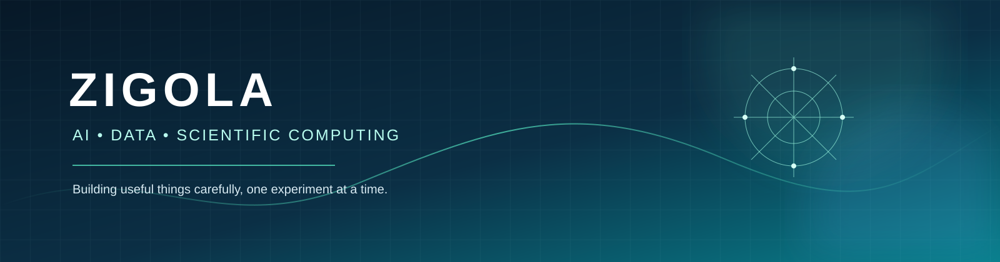

  

# Opal_208

**Biomedical sciences student · Developer in progress · Photographer & content creator**

I explore the intersection of science, software, data, and visual storytelling. This profile collects learning projects, experiments, and practical tools built with an emphasis on clear documentation and responsible development.

## Current areas of focus

- Scientific computing, biomedical sciences, and bioinformatics
- Python, data analysis, and reproducible experiments
- Artificial intelligence, retrieval systems, NLP, and computer vision
- Geospatial analysis and satellite-observation data
- Responsive web development and creative content

## Selected projects

| Project | What it explores |
| --- | --- |
| [PLEIADES](https://github.com/zigola/NASA-Space-Challenge-PLEIADES) | Experimental wildfire awareness using satellite observations, geospatial processing, and sensor simulation |
| [AI RAG Starter](https://github.com/zigola/ai-rag-starter-python) | Understandable retrieval-augmented generation building blocks |
| [AI Agents Workbench](https://github.com/zigola/ai-agents-workbench) | Bounded tools, planning, memory concepts, and evaluation |
| [Computer Vision Playground](https://github.com/zigola/computer-vision-playground) | Image-processing experiments with Python and OpenCV |
| [NLP Text Classification](https://github.com/zigola/nlp-text-classification) | Text classification baselines and evaluation practices |
| [Official Website](https://github.com/zigola/Site-officiel-zigola-) | Responsive personal website development |

## Tools and technologies

**Languages:** Python · JavaScript · HTML · CSS · SQL

**Scientific and AI interests:** NumPy · Pandas · scikit-learn · Streamlit · NLP · computer vision · geospatial data

**Development workflow:** Git · GitHub · VS Code · pytest · GitHub Actions · API integration

> Technologies listed here represent tools and areas I work with or study; they do not imply expert-level proficiency in every item.

## Explore and connect

- GitHub: https://github.com/zigola
- LinkedIn: https://www.linkedin.com/in/ahmed-elinany-6771402b
- Instagram: https://www.instagram.com/opal_208
- YouTube: https://youtube.com/@opal_208
- TikTok: https://www.tiktok.com/@opal.208

## Collaboration

I welcome constructive feedback, learning opportunities, and collaboration on well-scoped projects—especially in scientific computing, data quality, documentation, and responsible AI.

---

*Learn continuously. Build carefully. Share what works.*